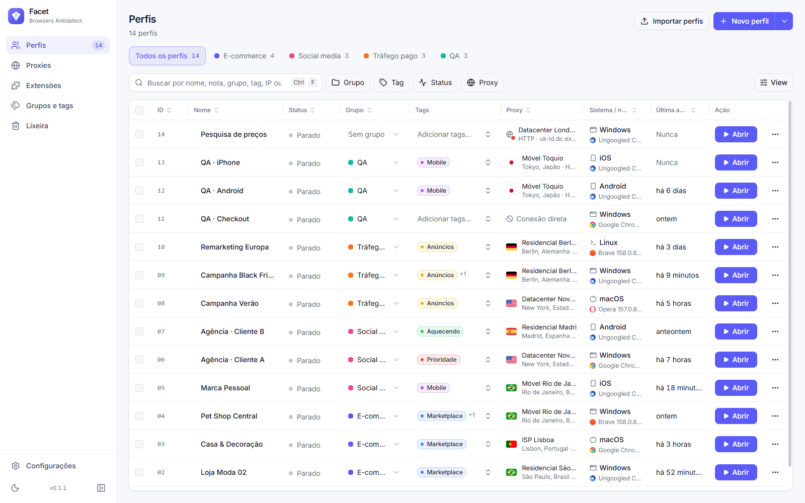
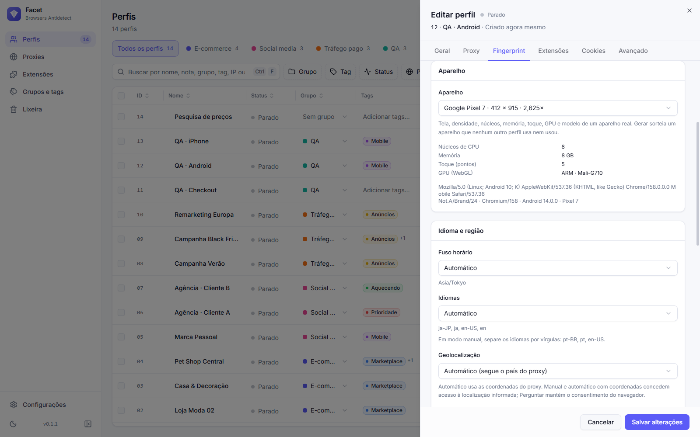
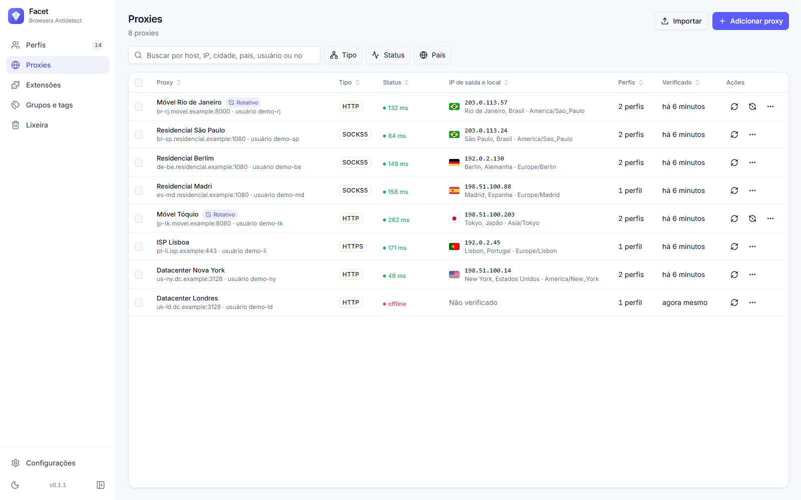
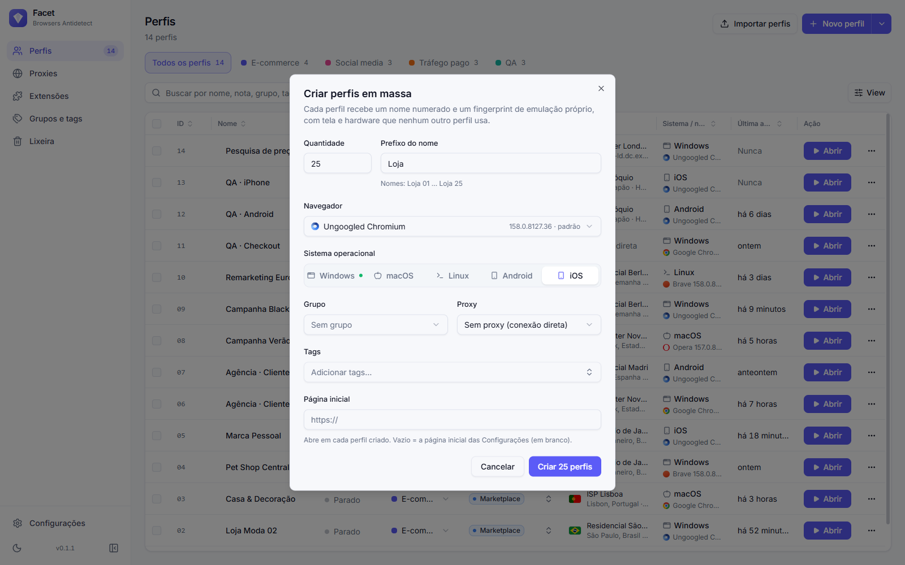
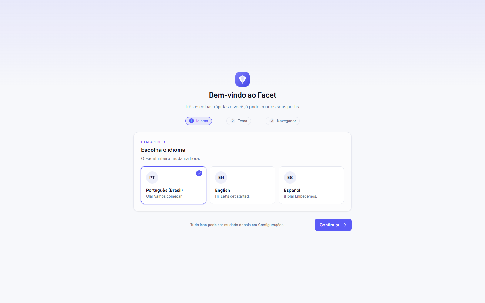

<div align="center">
  
  <h1>Facet Browsers Antidetect</h1>
  <p>
    <strong>Many isolated browsers on your computer, one for each account.</strong><br>
    Proxy, fingerprint, cookies and extensions per profile, with no cloud and no sign-up.
  </p>
  <p>
    <a href="#install"></a>
    <a href="package.json"></a>
    <a href="#features"></a>
    <a href="https://github.com/fcltz/Facet/stargazers"></a>
  </p>
  <p>
    <a href="#install">Install</a> ·
    <a href="#features">Features</a> ·
    <a href="#browsers">Browsers</a> ·
    <a href="#privacy">Privacy</a> ·
    <a href="INSTALL.md">AI install guide</a> ·
    <a href="docs/ARCHITECTURE.md">Architecture</a>
  </p>
  <p><a href="README.md">Português</a> · <b>English</b> · <a href="README.es.md">Español</a></p>
</div>

Agencies, online stores, social media and QA teams need to keep many accounts on one computer without one leaking into another. Facet gives each account its own browsing environment, with its own folder, its own proxy and a fingerprint that matches the IP, using the bundled Ungoogled Chromium or the Chrome, Brave and Opera you already have installed.

<p align="center">
<picture>
  <source media="(prefers-color-scheme: dark)" srcset="docs/images/profiles-dark.png">
  
</picture>
<br>
<sub>Real screenshot of the app with fictitious data. The interface is also available in English and Spanish.</sub>
</p>

## Install

| System          | Package                                    | x64 | Status                                |
| --------------- | ------------------------------------------ | :-: | ------------------------------------- |
| Windows 10 / 11 | Installer (`Facet-Setup-<version>.exe`)    | ✅  | Validated                             |
| Windows 10 / 11 | Executable folder (`release/win-unpacked`) | ✅  | Validated                             |
| macOS / Linux   | —                                          |  —  | Part of the code is ready, no package |

Published installers live under [Releases](https://github.com/fcltz/Facet/releases). To build your own from source, with **Git** and **Node.js 24** installed:

```powershell
git clone https://github.com/fcltz/Facet.git
cd Facet
npm ci          # exact dependencies from package-lock.json
npm run dist    # downloads Electron and Ungoogled Chromium (SHA-256 checked) and builds the installer
```

The installer shows up as `release\Facet-Setup-0.1.1.exe`. It installs per user, lets you pick the folder, creates shortcuts and includes an uninstaller.

> [!TIP]
> Asking an AI to install it on your PC? Hand it **[INSTALL.md](INSTALL.md)**: it has the step-by-step, the checks and the precautions that keep existing profiles safe.

<details>
<summary>Requirements</summary>

- Windows 10 or 11 x64, internet access for the first setup and about **3 GB free**.
- **Node.js 24.x** with npm (`package.json` also accepts 22.13+ and 26+) and **Git**.
- The native Windows helper (per-profile taskbar button and process queries) is compiled with the .NET Framework 4 `csc.exe` that ships with Windows. Visual Studio is not needed: SQLite uses prebuilt binaries.

</details>

<details>
<summary>Run without installing</summary>

```powershell
npm run dev                       # interface with live reload
npm run pack                      # builds release\win-unpacked
.\release\win-unpacked\Facet.exe
```

Ship the whole `win-unpacked` folder, not just the executable.

</details>

<details>
<summary>Windows warned me when opening the installer</summary>

A locally built installer has no digital signature, so SmartScreen may show a warning. If you built the file yourself from this repository, use **More info → Run anyway**. Do not turn off Windows protections.

</details>

<details>
<summary>Update an installation</summary>

```powershell
git pull --ff-only
npm ci
npm run dist
```

Close Facet and install over the old version. Profiles and settings live in `%APPDATA%\Facet` and are kept.

</details>

## Features

Everything a profile needs to look like a different computer, organized in a single table.

<table>
  <tr>
    <td width="50%" valign="top">
      <picture>
        <source media="(prefers-color-scheme: dark)" srcset="docs/images/fingerprint-dark.png">
        
      </picture>
      <br><b>Desktop and mobile fingerprints</b>
      <br>Windows, macOS and Linux, or 9 Android devices and 8 iPhones, with time zone, language and location following the proxy IP.
    </td>
    <td width="50%" valign="top">
      <picture>
        <source media="(prefers-color-scheme: dark)" srcset="docs/images/proxies-dark.png">
        
      </picture>
      <br><b>Proxies checked through the proxy itself</b>
      <br>HTTP, HTTPS and SOCKS5 with or without a password, bulk import, IP, country and latency, and IP rotation for rotating proxies.
    </td>
  </tr>
  <tr>
    <td width="50%" valign="top">
      <picture>
        <source media="(prefers-color-scheme: dark)" srcset="docs/images/bulk-dark.png">
        
      </picture>
      <br><b>Bulk creation</b>
      <br>Up to 500 profiles at once, with system, browser, group, tags and proxy, and a different device for each phone.
    </td>
    <td width="50%" valign="top">
      <picture>
        <source media="(prefers-color-scheme: dark)" srcset="docs/images/welcome-dark.png">
        
      </picture>
      <br><b>Guided first launch</b>
      <br>Language, light or dark theme and default browser, with the browsers on your computer detected on the spot.
    </td>
  </tr>
</table>

| Area                    | What you get                                                                                                                                                              |
| ----------------------- | ------------------------------------------------------------------------------------------------------------------------------------------------------------------------- |
| **Profiles**            | Its own folder for each profile, many open at once, groups, tags, notes, colors, search, filters, bulk selection, cloning and a trash bin.                                |
| **Browsers**            | Ungoogled Chromium bundled as the default; Chrome, Brave and Opera detected automatically. Each profile can use a different browser.                                      |
| **Proxies**             | A local proxy forwards to the authenticated proxy. Assign, swap or remove in bulk, with a prompt to restart open profiles.                                                |
| **IP protection**       | Refuses to open a profile if its proxy exits through your real IP. WebRTC goes through the proxy only by default.                                                         |
| **Extensions**          | `.zip`, `.crx`, unpacked folder or Chrome Web Store link. Mark defaults for new profiles and configure them on first launch.                                              |
| **Facet extension**     | Ad and tracker blocking with the uBlock Origin lists, less wasted resources and an indicator with IP, speed and proxy usage.                                              |
| **Cookies and bundles** | Import and export cookies as JSON or Netscape. Move profiles to another machine in bundles with an optional password.                                                     |
| **Backup**              | Manual or scheduled backups, restore with a copy of the previous state, and moving the profiles folder.                                                                   |
| **Interface**           | Portuguese, English and Spanish, light or dark theme, and shortcuts such as <kbd>Ctrl</kbd>+<kbd>N</kbd>, <kbd>Ctrl</kbd>+<kbd>Shift</kbd>+<kbd>N</kbd> and <kbd>?</kbd>. |

## Browsers

| Browser                | How it gets to Facet                | Extensions                      |
| ---------------------- | ----------------------------------- | ------------------------------- |
| **Ungoogled Chromium** | Bundled with the installer; default | Loaded when the profile opens   |
| **Google Chrome**      | Detected when installed             | Through Chrome's debugging pipe |
| **Brave**              | Detected when installed             | Loaded when the profile opens   |
| **Opera**              | Detected when installed             | Loaded when the profile opens   |

Your personal browser profiles are never used: Facet opens each profile in a folder of its own. The default browser applies to new profiles, and each profile can pick another one when created.

<details>
<summary>Emulation limits</summary>

- The emulated iPhone runs on Chromium, not Safari. Sites that probe the engine in depth may notice, and fonts stay the Windows ones.
- No fingerprint setting guarantees anonymity or an identity indistinguishable from a real device.
- Switching the browser of a profile that has been used may lose logins and cookies. To keep the original environment, create another profile instead.
- In Chrome, profiles with extensions close if Facet crashes, because they depend on the debugging pipe.
- The bundled Ungoogled Chromium has a fixed version and is only updated with a new Facet release.
- Opera GX is not supported.

</details>

## Privacy

- No account and no cloud: profiles, proxies and settings stay in `%APPDATA%\Facet`, on your computer.
- Facet has no telemetry and sends no usage data to third parties.
- Proxy passwords and IP-change URLs are encrypted by the system vault (Electron `safeStorage`).
- Each profile keeps cookies, cache and site data in a separate folder.
- IP and location checks of a proxy go through the proxy itself. The leak protection compares the exit IP with your real IP.
- The extension indicator queries Cloudflare to show IP and speed. Electron, Ungoogled Chromium and Chrome Web Store downloads come from their official sources.
- Exported cookies and backups grant access to accounts: keep them somewhere private.

## Development

| Command               | Purpose                                             |
| --------------------- | --------------------------------------------------- |
| `npm run dev`         | Open the app with live reload                       |
| `npm run typecheck`   | Check TypeScript types                              |
| `npm run lint`        | Run ESLint                                          |
| `npm test`            | Unit and integration tests, including real browsers |
| `npm run test:e2e`    | Test the interface in Electron with isolated data   |
| `npm run docs:images` | Regenerate the README images with fictitious data   |
| `npm run pack`        | Build the Windows executable folder                 |
| `npm run dist`        | Build the NSIS installer                            |

**Stack:** Electron · React · TypeScript · Vite · Tailwind CSS · shadcn/ui · Zustand · TanStack Table · SQLite with Drizzle · Playwright · Vitest.

Code structure, local data and how the browsers are driven are described in [docs/ARCHITECTURE.md](docs/ARCHITECTURE.md) (in Portuguese).

## Contributing

- Report bugs in [Issues](https://github.com/fcltz/Facet/issues) with the Facet version, the Windows version, the browser and the steps to reproduce.
- Remove passwords, cookies, tokens and personal data from screenshots and logs before sharing.
- Run `npm run typecheck`, `npm run lint` and `npm run test -- tests/unit` before proposing a change.
- Keep the texts in Portuguese, English and Spanish: `src/renderer/i18n` and `resources/facet-extension/_locales`.
- AI agents should follow [AGENTS.md](AGENTS.md).

## License

No license has been chosen for the Facet code yet. The filter lists bundled with the extension keep their own licenses (GPL-3.0, CC BY-SA 3.0 and others), described in [NOTICE.txt](resources/facet-extension/NOTICE.txt).
