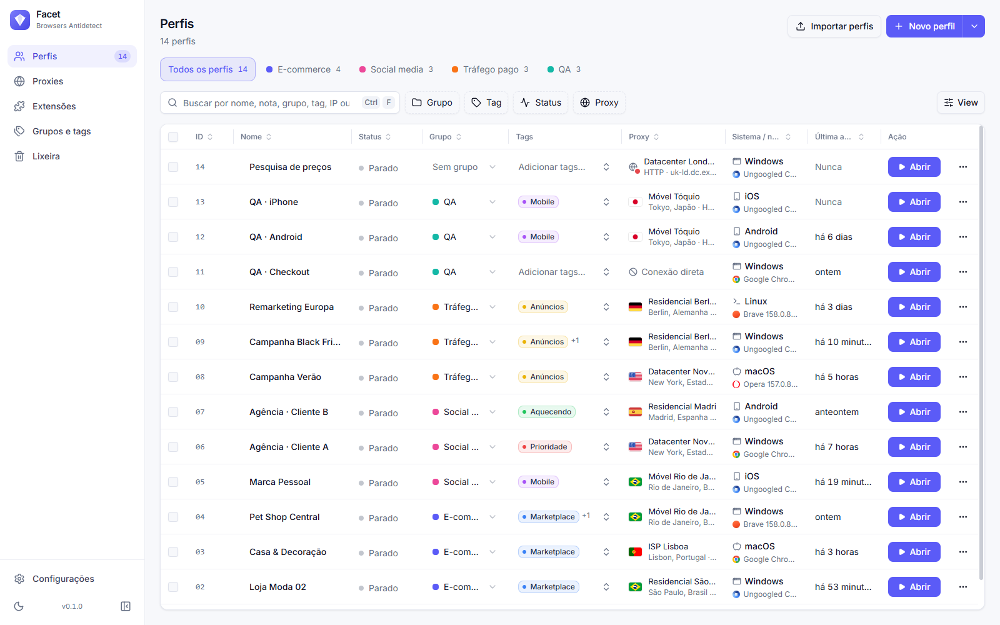
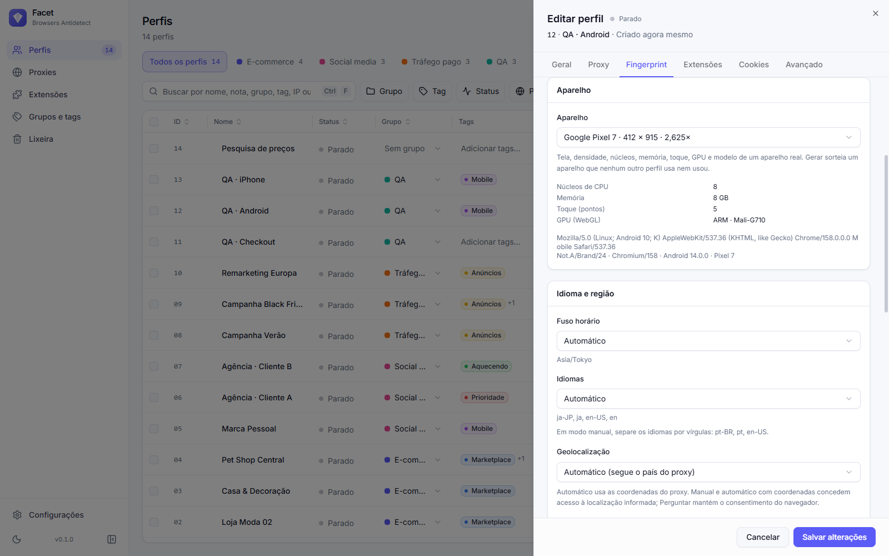
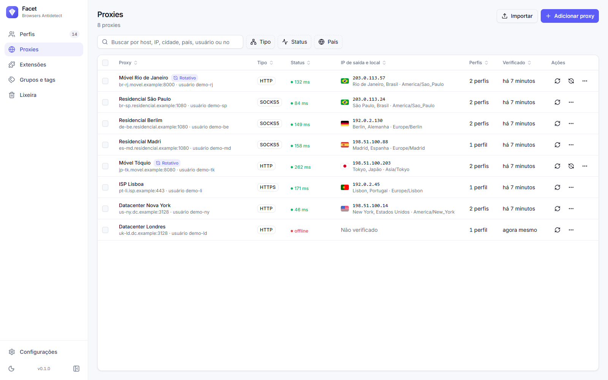
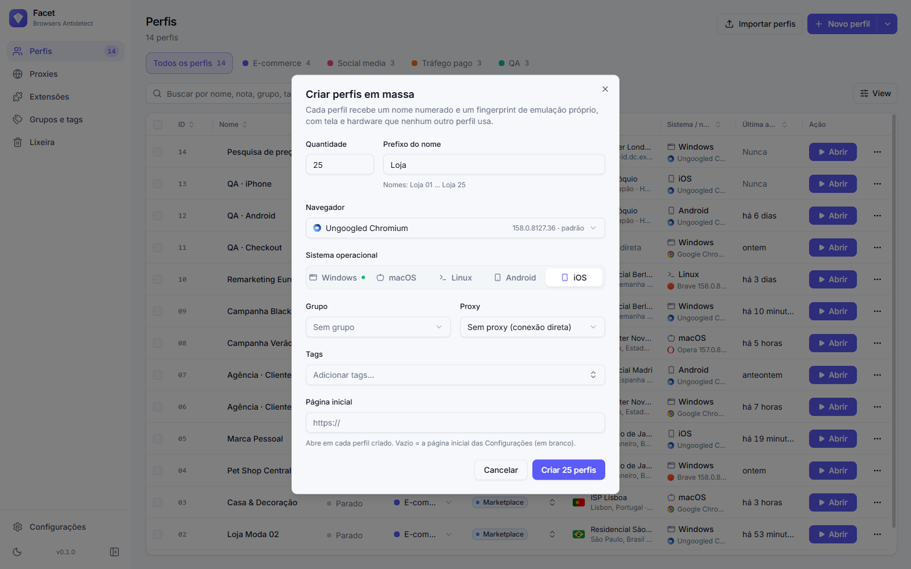
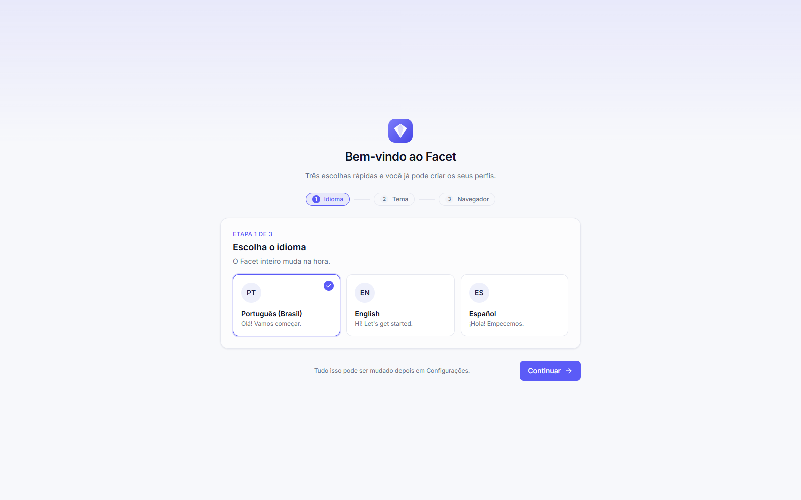

<div align="center">
  
  <h1>Facet Browsers Antidetect</h1>
  <p>
    <strong>Varios navegadores aislados en tu equipo, uno para cada cuenta.</strong><br>
    Proxy, huella, cookies y extensiones por perfil, sin nube y sin registro.
  </p>
  <p>
    <a href="#instalar"></a>
    <a href="package.json"></a>
    <a href="#funciones"></a>
    <a href="https://github.com/fcltz/Facet/stargazers"></a>
  </p>
  <p>
    <a href="#instalar">Instalar</a> ·
    <a href="#funciones">Funciones</a> ·
    <a href="#navegadores">Navegadores</a> ·
    <a href="#privacidad">Privacidad</a> ·
    <a href="INSTALL.md">Instalación con IA</a> ·
    <a href="docs/ARCHITECTURE.md">Arquitectura</a>
  </p>
  <p><a href="README.md">Português</a> · <a href="README.en.md">English</a> · <b>Español</b></p>
</div>

Agencias, tiendas en línea y equipos de redes sociales y de QA necesitan mantener muchas cuentas en el mismo equipo sin que una contamine a otra. Facet crea un entorno de navegación separado para cada cuenta, con su propia carpeta, su propio proxy y una huella coherente con la IP, usando el Ungoogled Chromium incluido o el Chrome, Brave y Opera que ya tienes instalados.

<p align="center">
<picture>
  <source media="(prefers-color-scheme: dark)" srcset="docs/images/profiles-dark.png">
  
</picture>
<br>
<sub>Captura real de la aplicación con datos ficticios. La interfaz también está en español e inglés.</sub>
</p>

## Instalar

| Sistema         | Paquete                                     | x64 | Estado                              |
| --------------- | ------------------------------------------- | :-: | ----------------------------------- |
| Windows 10 / 11 | Instalador (`Facet-Setup-<versión>.exe`)    | ✅  | Validado                            |
| Windows 10 / 11 | Carpeta ejecutable (`release/win-unpacked`) | ✅  | Validado                            |
| macOS / Linux   | —                                           |  —  | Parte del código lista, sin paquete |

Los instaladores publicados están en [Releases](https://github.com/fcltz/Facet/releases). Para generar el tuyo desde el código, con **Git** y **Node.js 24** instalados:

```powershell
git clone https://github.com/fcltz/Facet.git
cd Facet
npm ci          # dependencias exactas del package-lock.json
npm run dist    # descarga Electron y Ungoogled Chromium (SHA-256 verificado) y genera el instalador
```

El instalador aparece en `release\Facet-Setup-0.1.0.exe`. Se instala por usuario, permite elegir la carpeta, crea accesos directos e incluye desinstalador.

> [!TIP]
> ¿Vas a pedirle a una IA que lo instale en tu PC? Entrégale el **[INSTALL.md](INSTALL.md)**: tiene el paso a paso, las comprobaciones y los cuidados para no borrar perfiles existentes.

<details>
<summary>Requisitos</summary>

- Windows 10 u 11 x64, conexión a internet en la primera preparación y unos **3 GB libres**.
- **Node.js 24.x** con npm (el `package.json` también acepta 22.13+ y 26+) y **Git**.
- La utilidad de la barra de tareas se compila con el `csc.exe` de .NET Framework 4, que ya viene con Windows. No hace falta Visual Studio: SQLite usa binarios precompilados.

</details>

<details>
<summary>Ejecutar sin instalar</summary>

```powershell
npm run dev                       # interfaz con recarga automática
npm run pack                      # genera release\win-unpacked
.\release\win-unpacked\Facet.exe
```

Distribuye la carpeta `win-unpacked` completa, no solo el ejecutable.

</details>

<details>
<summary>Windows mostró un aviso al abrir el instalador</summary>

Un instalador generado localmente no tiene firma digital, así que SmartScreen puede mostrar un aviso. Si generaste el archivo tú mismo desde este repositorio, usa **Más información → Ejecutar de todas formas**. No desactives las protecciones de Windows.

</details>

<details>
<summary>Actualizar una instalación</summary>

```powershell
git pull --ff-only
npm ci
npm run dist
```

Cierra Facet e instala encima. Los perfiles y la configuración están en `%APPDATA%\Facet` y se conservan.

</details>

## Funciones

Todo lo que un perfil necesita para parecer otro equipo, organizado en una sola tabla.

<table>
  <tr>
    <td width="50%" valign="top">
      <picture>
        <source media="(prefers-color-scheme: dark)" srcset="docs/images/fingerprint-dark.png">
        
      </picture>
      <br><b>Huella de escritorio y de móvil</b>
      <br>Windows, macOS y Linux, o 9 dispositivos Android y 8 iPhone, con zona horaria, idioma y ubicación siguiendo la IP del proxy.
    </td>
    <td width="50%" valign="top">
      <picture>
        <source media="(prefers-color-scheme: dark)" srcset="docs/images/proxies-dark.png">
        
      </picture>
      <br><b>Proxies verificados a través del propio proxy</b>
      <br>HTTP, HTTPS y SOCKS5 con o sin contraseña, importación masiva, IP, país y latencia, y cambio de IP en los rotativos.
    </td>
  </tr>
  <tr>
    <td width="50%" valign="top">
      <picture>
        <source media="(prefers-color-scheme: dark)" srcset="docs/images/bulk-dark.png">
        
      </picture>
      <br><b>Creación masiva</b>
      <br>Hasta 500 perfiles a la vez, con sistema, navegador, grupo, etiquetas y proxy, y un dispositivo distinto para cada móvil.
    </td>
    <td width="50%" valign="top">
      <picture>
        <source media="(prefers-color-scheme: dark)" srcset="docs/images/welcome-dark.png">
        
      </picture>
      <br><b>Primer inicio guiado</b>
      <br>Idioma, tema claro u oscuro y navegador predeterminado, con los navegadores del equipo detectados al instante.
    </td>
  </tr>
</table>

| Área                    | Qué obtienes                                                                                                                                                  |
| ----------------------- | ------------------------------------------------------------------------------------------------------------------------------------------------------------- |
| **Perfiles**            | Carpeta propia para cada perfil, varios abiertos a la vez, grupos, etiquetas, notas, colores, búsqueda, filtros, selección masiva, clonado y papelera.        |
| **Navegadores**         | Ungoogled Chromium incluido como predeterminado; Chrome, Brave y Opera detectados automáticamente. Cada perfil puede usar un navegador distinto.              |
| **Proxies**             | Un proxy local reenvía al proxy autenticado. Asigna, cambia o quita en masa, con aviso para reiniciar los perfiles abiertos.                                  |
| **Protección de la IP** | Se niega a abrir el perfil si el proxy sale por tu IP real. WebRTC pasa solo por el proxy de forma predeterminada.                                            |
| **Extensiones**         | `.zip`, `.crx`, carpeta descomprimida o enlace de la Chrome Web Store. Marca las predeterminadas para los perfiles nuevos y configúralas en el primer inicio. |
| **Extensión Facet**     | Bloqueo de anuncios y rastreadores con las listas de uBlock Origin, menos recursos desperdiciados y un indicador de IP, velocidad y consumo del proxy.        |
| **Cookies y paquetes**  | Importa y exporta cookies en JSON o Netscape. Lleva perfiles a otro equipo en paquetes con contraseña opcional.                                               |
| **Copias de seguridad** | Copia manual o programada, restauración con copia del estado anterior y cambio de la carpeta de los perfiles.                                                 |
| **Interfaz**            | Portugués, inglés y español, tema claro u oscuro y atajos como <kbd>Ctrl</kbd>+<kbd>N</kbd>, <kbd>Ctrl</kbd>+<kbd>Shift</kbd>+<kbd>N</kbd> y <kbd>?</kbd>.    |

## Navegadores

| Navegador              | Cómo llega a Facet                        | Extensiones                          |
| ---------------------- | ----------------------------------------- | ------------------------------------ |
| **Ungoogled Chromium** | Incluido en el instalador; predeterminado | Se cargan al abrir el perfil         |
| **Google Chrome**      | Detectado cuando está instalado           | Por el canal de depuración de Chrome |
| **Brave**              | Detectado cuando está instalado           | Se cargan al abrir el perfil         |
| **Opera**              | Detectado cuando está instalado           | Se cargan al abrir el perfil         |

Tu perfil personal de cada navegador nunca se usa: Facet abre cada perfil en una carpeta propia. El navegador predeterminado vale para los perfiles nuevos, y al crearlo cada perfil puede elegir otro.

<details>
<summary>Límites de la emulación</summary>

- El iPhone emulado funciona sobre Chromium, no sobre Safari. Los sitios que analizan el motor a fondo pueden notarlo, y las fuentes siguen siendo las de Windows.
- Ningún ajuste de huella garantiza el anonimato ni una identidad imposible de distinguir de un dispositivo real.
- Cambiar el navegador de un perfil ya usado puede hacer perder sesiones y cookies. Para conservar el entorno original, crea otro perfil.
- En Chrome, los perfiles con extensiones se cierran si Facet falla, porque dependen del canal de depuración.
- El Ungoogled Chromium incluido tiene una versión fija y solo se actualiza con una nueva versión de Facet.
- Opera GX no es compatible.

</details>

## Privacidad

- No hay cuenta ni nube: los perfiles, proxies y la configuración se quedan en `%APPDATA%\Facet`, en tu equipo.
- Facet no tiene telemetría ni envía datos de uso a terceros.
- Las contraseñas de proxy y las URL de cambio de IP se cifran con el almacén del sistema (`safeStorage` de Electron).
- Cada perfil guarda cookies, caché y datos de los sitios en una carpeta separada.
- Las comprobaciones de IP y ubicación de un proxy pasan por el propio proxy. La protección contra fugas compara la IP de salida con tu IP real.
- El indicador de la extensión consulta a Cloudflare para mostrar la IP y la velocidad. Las descargas de Electron, Ungoogled Chromium y la Chrome Web Store vienen de sus fuentes oficiales.
- Las cookies exportadas y las copias de seguridad dan acceso a las cuentas: guárdalas en un lugar privado.

## Desarrollo

| Comando               | Para qué                                                           |
| --------------------- | ------------------------------------------------------------------ |
| `npm run dev`         | Abrir la aplicación con recarga automática                         |
| `npm run typecheck`   | Comprobar los tipos de TypeScript                                  |
| `npm run lint`        | Ejecutar ESLint                                                    |
| `npm test`            | Pruebas unitarias y de integración, incluso con navegadores reales |
| `npm run test:e2e`    | Probar la interfaz en Electron con datos aislados                  |
| `npm run docs:images` | Regenerar las imágenes de este README con datos ficticios          |
| `npm run pack`        | Generar la carpeta ejecutable de Windows                           |
| `npm run dist`        | Generar el instalador NSIS                                         |

**Stack:** Electron · React · TypeScript · Vite · Tailwind CSS · shadcn/ui · Zustand · TanStack Table · SQLite con Drizzle · Playwright · Vitest.

La estructura del código, los datos locales y el manejo de los navegadores están en [docs/ARCHITECTURE.md](docs/ARCHITECTURE.md) (en portugués).

## Contribuir

- Reporta errores en [Issues](https://github.com/fcltz/Facet/issues) con la versión de Facet, la de Windows, el navegador y los pasos para reproducirlo.
- Quita contraseñas, cookies, tokens y datos personales de capturas y registros antes de compartirlos.
- Ejecuta `npm run typecheck`, `npm run lint` y `npm run test -- tests/unit` antes de proponer un cambio.
- Mantén los textos en portugués, inglés y español: `src/renderer/i18n` y `resources/facet-extension/_locales`.
- Los agentes de IA deben seguir el [AGENTS.md](AGENTS.md).

## Historial de estrellas

<a href="https://star-history.com/#fcltz/Facet&Date">
  <picture>
    <source media="(prefers-color-scheme: dark)" srcset="https://api.star-history.com/svg?repos=fcltz/Facet&type=Date&theme=dark">
    
  </picture>
</a>

## Licencia

Todavía no se ha definido una licencia para el código de Facet. Las listas de filtros incluidas en la extensión conservan sus licencias (GPL-3.0, CC BY-SA 3.0 y otras), descritas en [NOTICE.txt](resources/facet-extension/NOTICE.txt).
