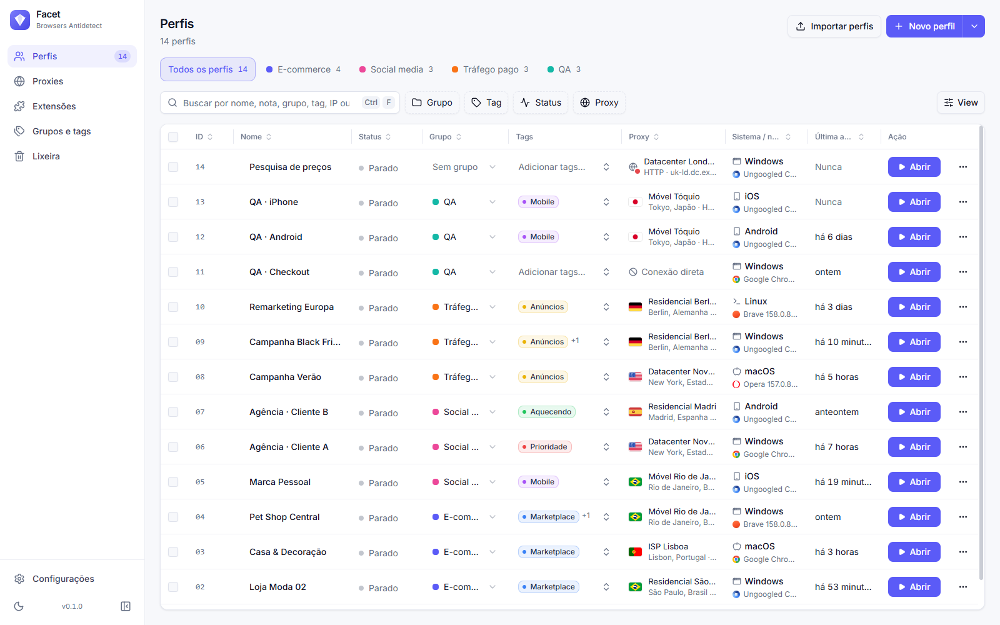
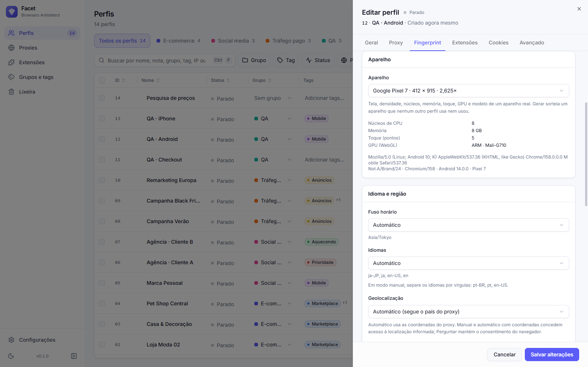
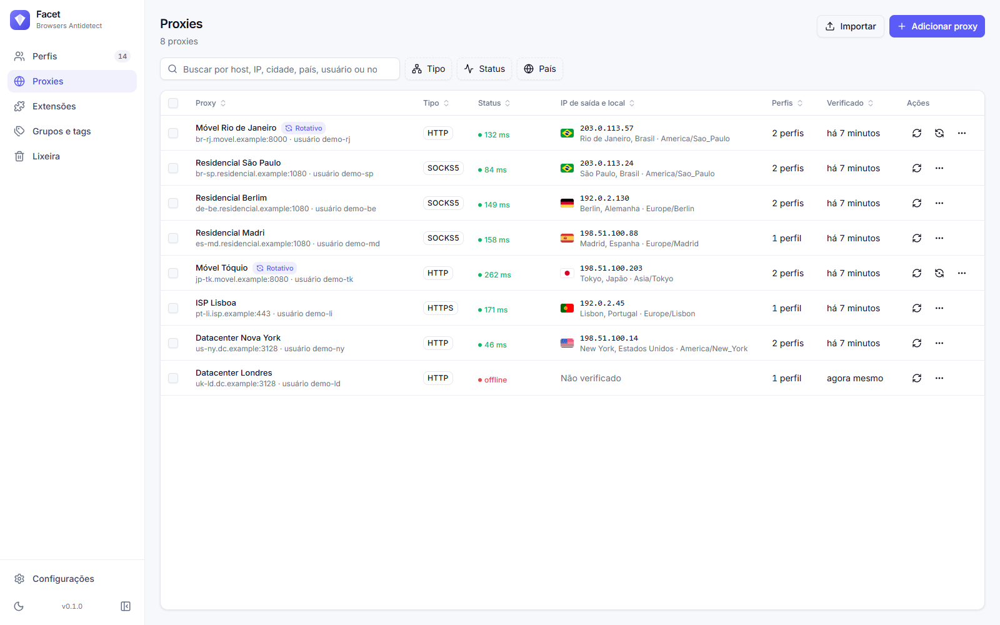
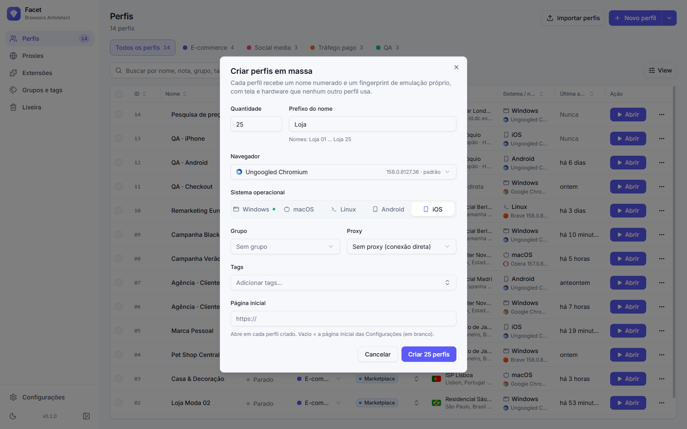
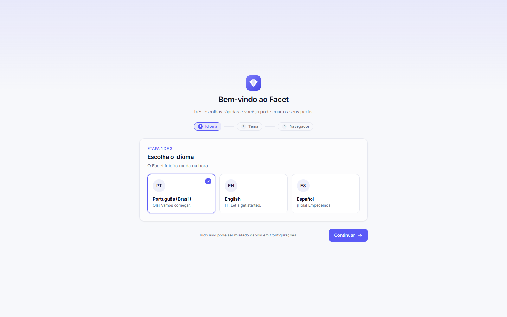

<div align="center">
  
  <h1>Facet Browsers Antidetect</h1>
  <p>
    <strong>Vários navegadores isolados no seu computador, um para cada conta.</strong><br>
    Proxy, fingerprint, cookies e extensões por perfil, sem nuvem e sem cadastro.
  </p>
  <p>
    <a href="#instalar"></a>
    <a href="package.json"></a>
    <a href="#recursos"></a>
    <a href="https://github.com/fcltz/Facet/stargazers"></a>
  </p>
  <p>
    <a href="#instalar">Instalar</a> ·
    <a href="#recursos">Recursos</a> ·
    <a href="#navegadores">Navegadores</a> ·
    <a href="#privacidade">Privacidade</a> ·
    <a href="INSTALL.md">Instalação por IA</a> ·
    <a href="docs/ARCHITECTURE.md">Arquitetura</a>
  </p>
  <p><b>Português</b> · <a href="README.en.md">English</a> · <a href="README.es.md">Español</a></p>
</div>

Agências, lojas virtuais, equipes de social media e de QA precisam manter muitas contas no mesmo computador sem que uma contamine a outra. O Facet cria um ambiente de navegação separado para cada conta, com pasta própria, proxy próprio e um fingerprint coerente com o IP, usando o Ungoogled Chromium incluído ou o Chrome, o Brave e o Opera que já estão instalados.

<p align="center">
<picture>
  <source media="(prefers-color-scheme: dark)" srcset="docs/images/profiles-dark.png">
  
</picture>
<br>
<sub>Captura real do aplicativo com dados fictícios.</sub>
</p>

## Instalar

| Sistema         | Pacote                                    | x64 | Situação                           |
| --------------- | ----------------------------------------- | :-: | ---------------------------------- |
| Windows 10 / 11 | Instalador (`Facet-Setup-<versão>.exe`)   | ✅  | Validado                           |
| Windows 10 / 11 | Pasta executável (`release/win-unpacked`) | ✅  | Validado                           |
| macOS / Linux   | —                                         |  —  | Parte do código pronta, sem pacote |

Os instaladores publicados ficam em [Releases](https://github.com/fcltz/Facet/releases). Para gerar o seu a partir do código, com **Git** e **Node.js 24** instalados:

```powershell
git clone https://github.com/fcltz/Facet.git
cd Facet
npm ci          # dependências exatas do package-lock.json
npm run dist    # baixa o Electron e o Ungoogled Chromium (SHA-256 conferido) e gera o instalador
```

O instalador aparece em `release\Facet-Setup-0.1.0.exe`. Ele é por usuário, deixa escolher a pasta, cria atalhos e tem desinstalador.

> [!TIP]
> Vai pedir para uma IA instalar no seu PC? Entregue o **[INSTALL.md](INSTALL.md)**: ele tem o passo a passo, as verificações e os cuidados para não apagar perfis existentes.

<details>
<summary>Pré-requisitos</summary>

- Windows 10 ou 11 x64, com internet na primeira preparação e cerca de **3 GB livres**.
- **Node.js 24.x** com npm (o `package.json` também aceita 22.13+ e 26+) e **Git**.
- O utilitário da barra de tarefas é compilado com o `csc.exe` do .NET Framework 4, que já vem no Windows. Não é preciso Visual Studio: o SQLite usa binários prontos.

</details>

<details>
<summary>Rodar sem instalar</summary>

```powershell
npm run dev                       # interface com recarga automática
npm run pack                      # gera release\win-unpacked
.\release\win-unpacked\Facet.exe
```

Distribua a pasta `win-unpacked` inteira, não só o executável.

</details>

<details>
<summary>O Windows avisou ao abrir o instalador</summary>

O instalador gerado localmente não tem assinatura digital, então o SmartScreen pode mostrar um aviso. Se foi você quem gerou o arquivo a partir deste repositório, use **Mais informações → Executar assim mesmo**. Não desative as proteções do Windows.

</details>

<details>
<summary>Atualizar uma instalação</summary>

```powershell
git pull --ff-only
npm ci
npm run dist
```

Feche o Facet e instale por cima. Perfis e configurações ficam em `%APPDATA%\Facet` e são mantidos.

</details>

## Recursos

Tudo o que um perfil precisa para parecer um computador diferente, organizado numa tabela só.

<table>
  <tr>
    <td width="50%" valign="top">
      <picture>
        <source media="(prefers-color-scheme: dark)" srcset="docs/images/fingerprint-dark.png">
        
      </picture>
      <br><b>Fingerprint de desktop e celular</b>
      <br>Windows, macOS e Linux, ou 9 aparelhos Android e 8 iPhones, com fuso, idioma e localização acompanhando o IP do proxy.
    </td>
    <td width="50%" valign="top">
      <picture>
        <source media="(prefers-color-scheme: dark)" srcset="docs/images/proxies-dark.png">
        
      </picture>
      <br><b>Proxies verificados pelo próprio proxy</b>
      <br>HTTP, HTTPS e SOCKS5 com ou sem senha, importação em massa, IP, país e latência, e troca de IP nos rotativos.
    </td>
  </tr>
  <tr>
    <td width="50%" valign="top">
      <picture>
        <source media="(prefers-color-scheme: dark)" srcset="docs/images/bulk-dark.png">
        
      </picture>
      <br><b>Criação em massa</b>
      <br>Até 500 perfis por vez, com sistema, navegador, grupo, tags e proxy, e um aparelho diferente para cada celular.
    </td>
    <td width="50%" valign="top">
      <picture>
        <source media="(prefers-color-scheme: dark)" srcset="docs/images/welcome-dark.png">
        
      </picture>
      <br><b>Primeira abertura guiada</b>
      <br>Idioma, tema claro ou escuro e navegador padrão, com os navegadores do computador detectados na hora.
    </td>
  </tr>
</table>

| Área                  | O que você ganha                                                                                                                                              |
| --------------------- | ------------------------------------------------------------------------------------------------------------------------------------------------------------- |
| **Perfis**            | Pasta própria para cada perfil, vários abertos ao mesmo tempo, grupos, tags, notas, cores, busca, filtros, seleção em massa, clone e lixeira.                 |
| **Navegadores**       | Ungoogled Chromium incluído como padrão; Chrome, Brave e Opera detectados sozinhos. Cada perfil pode usar um navegador diferente.                             |
| **Proxies**           | Um proxy local repassa para o proxy autenticado. Atribuir, trocar ou remover em massa, com aviso para reiniciar os perfis abertos.                            |
| **Proteção do IP**    | Recusa abrir o perfil se o proxy estiver saindo pelo seu IP real. WebRTC passa só pelo proxy por padrão.                                                      |
| **Extensões**         | `.zip`, `.crx`, pasta descompactada ou link da Chrome Web Store. Marque as padrão para entrarem nos perfis novos e configure-as na 1ª abertura.               |
| **Extensão Facet**    | Bloqueio de anúncios e rastreadores com as listas do uBlock Origin, menos recursos desperdiçados e um indicador de IP, velocidade e gasto do proxy.           |
| **Cookies e pacotes** | Importe e exporte cookies em JSON ou Netscape. Leve perfis para outra máquina em pacotes com senha opcional.                                                  |
| **Backup**            | Backup manual ou agendado, restauração com cópia do estado anterior e mudança da pasta dos perfis.                                                            |
| **Interface**         | Português, inglês e espanhol, tema claro ou escuro e atalhos como <kbd>Ctrl</kbd>+<kbd>N</kbd>, <kbd>Ctrl</kbd>+<kbd>Shift</kbd>+<kbd>N</kbd> e <kbd>?</kbd>. |

## Navegadores

| Navegador              | Como chega ao Facet                    | Extensões                         |
| ---------------------- | -------------------------------------- | --------------------------------- |
| **Ungoogled Chromium** | Incluído no instalador; padrão inicial | Carregadas na abertura do perfil  |
| **Google Chrome**      | Detectado quando instalado             | Pelo canal de depuração do Chrome |
| **Brave**              | Detectado quando instalado             | Carregadas na abertura do perfil  |
| **Opera**              | Detectado quando instalado             | Carregadas na abertura do perfil  |

O seu perfil pessoal de cada navegador nunca é usado: o Facet abre cada perfil numa pasta própria. O navegador padrão vale para os perfis novos, e na criação cada perfil pode escolher outro.

<details>
<summary>Limites da emulação</summary>

- O iPhone emulado roda sobre o Chromium, não sobre o Safari. Sites que testam o motor a fundo podem perceber, e as fontes continuam as do Windows.
- Nenhum ajuste de fingerprint garante anonimato ou uma identidade impossível de distinguir de um aparelho real.
- Trocar o navegador de um perfil já usado pode perder logins e cookies. Para manter o ambiente original, prefira criar outro perfil.
- No Chrome, os perfis com extensões fecham junto se o Facet cair, porque dependem do canal de depuração.
- O Ungoogled Chromium incluído tem versão fixa e só é atualizado junto com uma nova versão do Facet.
- Opera GX não é suportado.

</details>

## Privacidade

- Não há conta nem nuvem: perfis, proxies e configurações ficam em `%APPDATA%\Facet`, no seu computador.
- O Facet não tem telemetria nem envia dados de uso a terceiros.
- Senhas de proxy e URLs de troca de IP são cifradas pelo cofre do sistema (`safeStorage` do Electron).
- Cada perfil guarda cookies, cache e dados dos sites numa pasta separada.
- As verificações de IP e localização de um proxy passam pelo próprio proxy. A proteção contra vazamento compara o IP de saída com o seu IP real.
- O indicador da extensão consulta a Cloudflare para mostrar IP e velocidade. Os downloads do Electron, do Ungoogled Chromium e da Chrome Web Store vêm das fontes oficiais.
- Cookies exportados e backups dão acesso às contas: guarde-os em local privado.

## Desenvolvimento

| Comando               | Para quê                                                          |
| --------------------- | ----------------------------------------------------------------- |
| `npm run dev`         | Abrir o app com recarga automática                                |
| `npm run typecheck`   | Conferir os tipos do TypeScript                                   |
| `npm run lint`        | Rodar o ESLint                                                    |
| `npm test`            | Testes unitários e de integração, inclusive com navegadores reais |
| `npm run test:e2e`    | Testar a interface no Electron, com dados isolados                |
| `npm run docs:images` | Regerar as imagens deste README com dados fictícios               |
| `npm run pack`        | Gerar a pasta executável do Windows                               |
| `npm run dist`        | Gerar o instalador NSIS                                           |

**Stack:** Electron · React · TypeScript · Vite · Tailwind CSS · shadcn/ui · Zustand · TanStack Table · SQLite com Drizzle · Playwright · Vitest.

A estrutura do código, os dados locais e o funcionamento dos navegadores estão em [docs/ARCHITECTURE.md](docs/ARCHITECTURE.md).

## Contribuir

- Relate erros em [Issues](https://github.com/fcltz/Facet/issues) com a versão do Facet, a do Windows, o navegador e os passos para reproduzir.
- Remova senhas, cookies, tokens e dados pessoais de capturas e logs antes de compartilhar.
- Rode `npm run typecheck`, `npm run lint` e `npm run test -- tests/unit` antes de propor uma mudança.
- Mantenha os textos em português, inglês e espanhol: `src/renderer/i18n` e `resources/facet-extension/_locales`.
- Agentes de IA devem seguir o [AGENTS.md](AGENTS.md).

## Histórico de estrelas

<a href="https://star-history.com/#fcltz/Facet&Date">
  <picture>
    <source media="(prefers-color-scheme: dark)" srcset="https://api.star-history.com/svg?repos=fcltz/Facet&type=Date&theme=dark">
    
  </picture>
</a>

## Licença

Ainda não há uma licença definida para o código do Facet. As listas de filtros incluídas na extensão mantêm as licenças delas (GPL-3.0, CC BY-SA 3.0 e outras), descritas em [NOTICE.txt](resources/facet-extension/NOTICE.txt).
